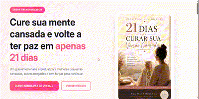

# 📖 21 Dias para Curar sua Versão Cansada

> **Landing page** para apresentação e divulgação de um **livro digital** — projeto de desenvolvimento web com foco em apresentação visual, comunicação com o público e conversão para compra.

Página estática desenvolvida com **HTML, CSS e JavaScript**, construída para apresentar o produto digital *21 Dias para Curar sua Versão Cansada* de forma organizada, comunicativa e orientada à ação do visitante.

---

## 📖 Sobre o projeto

Este projeto consiste em uma **landing page** criada para divulgação de um livro digital na plataforma **Eduzz**. A proposta é apresentar o produto ao visitante de maneira clara, comunicar sua finalidade e facilitar o acesso à página de compra.

A página foi pensada como peça de **marketing digital**, unindo design limpo, hierarquia visual bem definida e chamadas para ação (CTA) que direcionam o usuário à oferta.

### 🎯 Problema que resolve

Oferecer uma **vitrine digital profissional** para um produto digital, permitindo que o visitante compreenda a proposta do livro e seja direcionado à compra de forma intuitiva — sem depender de plataformas genéricas de e-commerce.

### 👥 Público-alvo

- Pessoas interessadas em desenvolvimento pessoal e bem-estar emocional
- Visitantes vindos de campanhas de divulgação
- Potenciais compradores do livro digital

---

## ✨ Funcionalidades

- Apresentação visual do produto digital 📖
- Layout responsivo e hierarquia visual bem definida
- Comunicação clara da proposta do livro
- Direcionamento do visitante para a página de compra (Eduzz)
- Animações e interatividade com JavaScript
- Estrutura leve, sem dependências externas pesadas

---

## 🚀 Tecnologias Utilizadas

| Tecnologia | Finalidade |
|---|---|
| **HTML5** | Estrutura semântica e conteúdo da página |
| **CSS3** | Estilização, layout responsivo e apresentação visual |
| **JavaScript Vanilla** | Interatividade da interface e animações |

---

## 🧠 Decisões técnicas & aprendizados

- **Página estática com foco em conversão**: estrutura pensada para guiar o visitante da apresentação do produto até a oferta, com CTAs bem posicionados.
- **Separação de responsabilidades**: `index.html` (estrutura), `style.css` (apresentação) e `script.js` (comportamento) organizados de forma clara.
- **Vanilla JS em vez de frameworks**: escolha consciente para manter o bundle leve, carregamento rápido e código de fácil manutenção.
- **Responsividade mobile-first**: boa parte do tráfego de campanhas vem de dispositivos móveis, então o layout foi pensado para funcionar bem neles.
- **Integração com plataforma externa**: direcionamento para a página de compra na Eduzz, mantendo a landing page focada apenas em apresentação e conversão.

---

## 📷 Demonstração

🔗 [**Acessar o projeto**](https://wesleyorrr.github.io/21-dias-para-curar-sua-versao-cansada/)

🎬 **Demonstração animada:**

